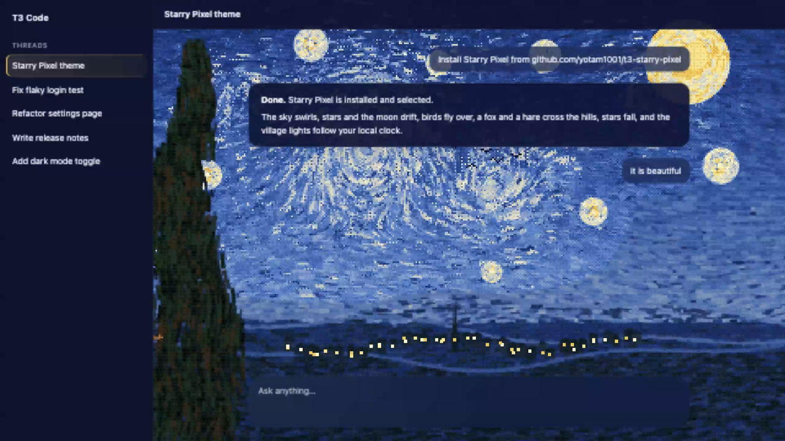

# Starry Pixel for T3 Code

An animated, pixel-art night sky behind [T3 Code](https://t3.codes), painted in the spirit of
Van Gogh's *The Starry Night* (1889).

https://github.com/yotam1001/t3-starry-pixel/releases/latest/download/starry-pixel-demo.mp4

- The sky really swirls: the pixels flow around each swirl.
- Stars and the moon drift and twinkle.
- Flocks of birds fly over, and a fox and a hare cross the hills behind the cypress.
- Falling stars, every few seconds.
- The village lights follow your local clock: all lit in the morning, mostly dark late at night.
- Motion stops when your OS asks for reduced motion.

Works on **Windows and macOS**.

## Install

Tell your agent inside T3:

> Install the Starry Pixel theme from https://github.com/yotam1001/t3-starry-pixel, following its INSTALL.md

That's it. T3 closes and reopens once by itself, with Starry Pixel on.

Prefer doing it yourself? Download `starry-pixel-windows.zip` or `starry-pixel-macos.zip` from
[Releases](https://github.com/yotam1001/t3-starry-pixel/releases/latest), unzip, and run
`python3 install.py install`. Remove it with `python3 install.py uninstall`.

## How it works

T3's theme feature only takes colors, so the wallpaper and animation are added by patching T3's
bundled CSS and JS (inside its `.asar` archive) with `theme/starry-pixel.css` and `theme/engine.js`.
Everything is scoped to `html[data-theme-id="starry-pixel"]`, so picking any other theme in T3's
menu turns it off. A colors-only entry in `~/.t3/userdata/themes/` puts it in the theme menu.

The installer verifies every other file in the archive byte for byte and keeps backups. See
[INSTALL.md](INSTALL.md) for exactly what changes.

**Heads up**

- This is an unofficial mod, not made by or affiliated with the T3 team.
- T3 updates remove it; just install again.
- On macOS the app gets re-signed ad hoc, which can stop T3's auto-update. Uninstall restores the original, signed app.

## Source

- `theme/`: the built theme (CSS with the wallpaper embedded, the animation engine, the menu entry).
- `source/`: the wallpaper layers and the Python generators used to paint them.
- `demo/`: a standalone page that previews the theme in a browser.

## License

MIT. The wallpaper is original procedural pixel art inspired by a public-domain painting.
